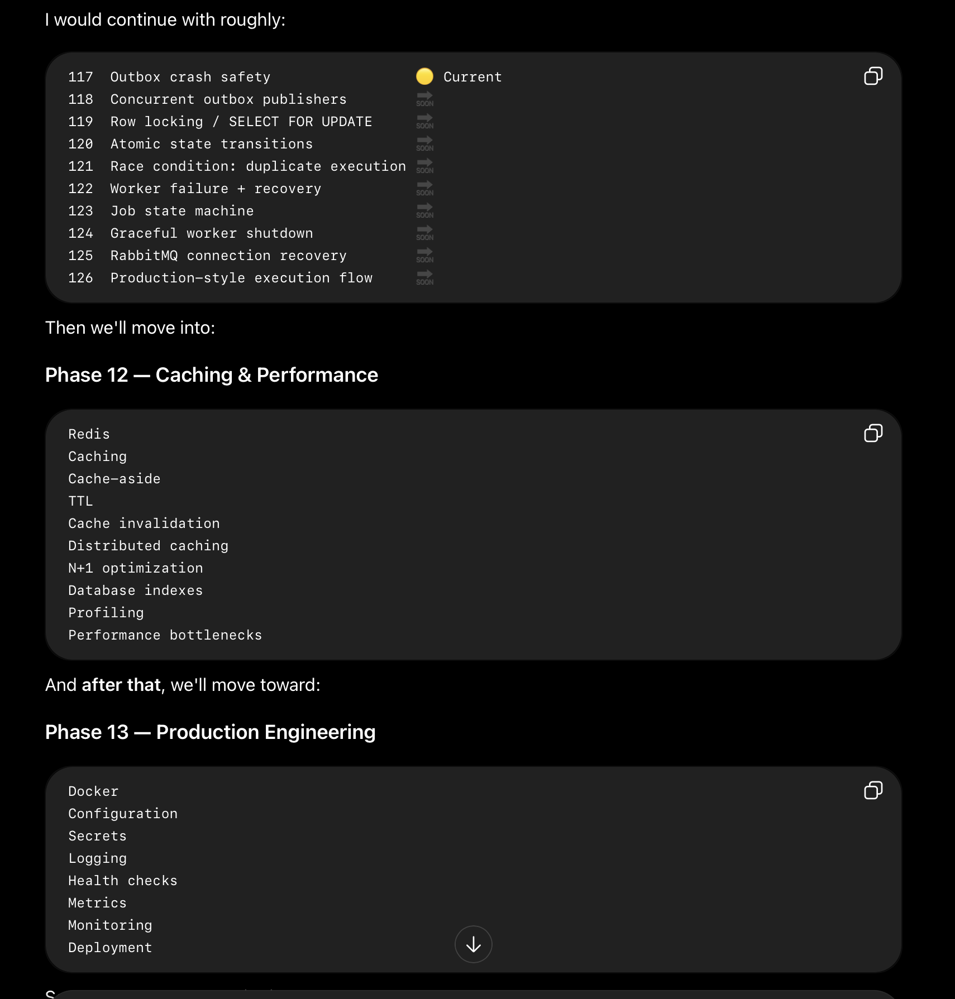
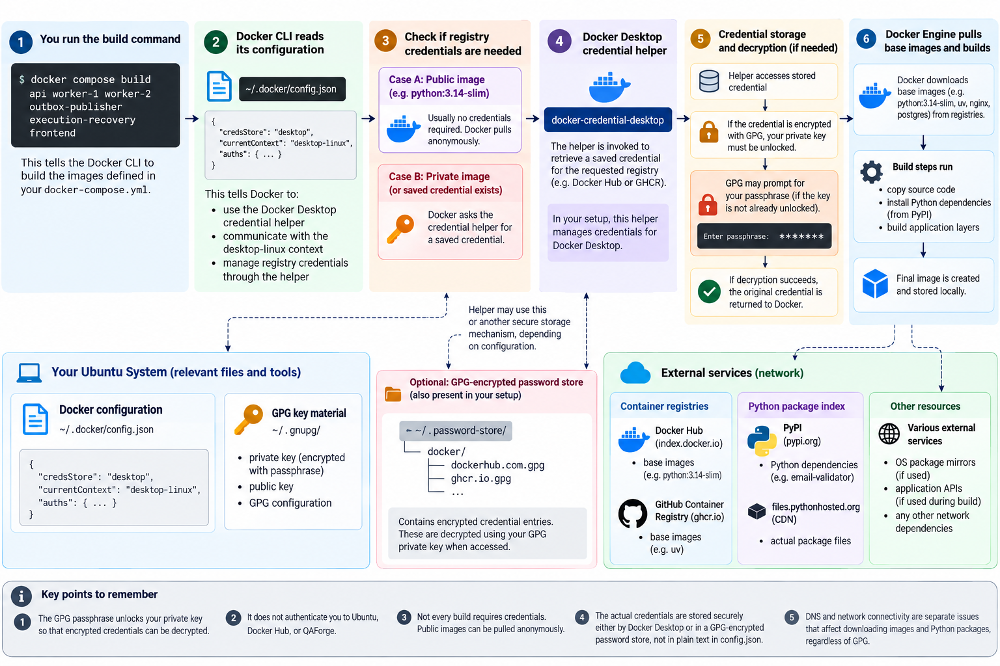
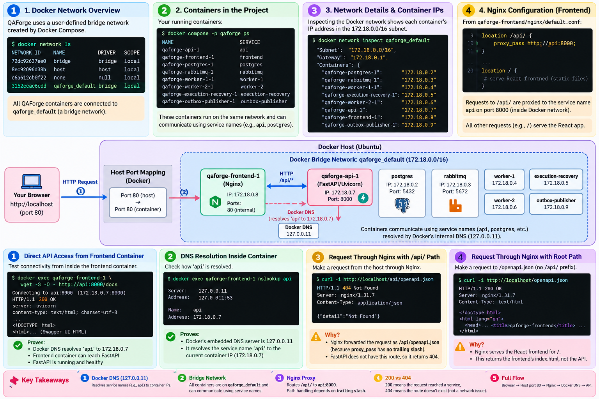
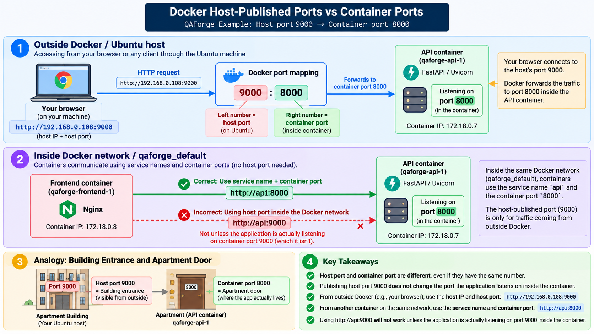
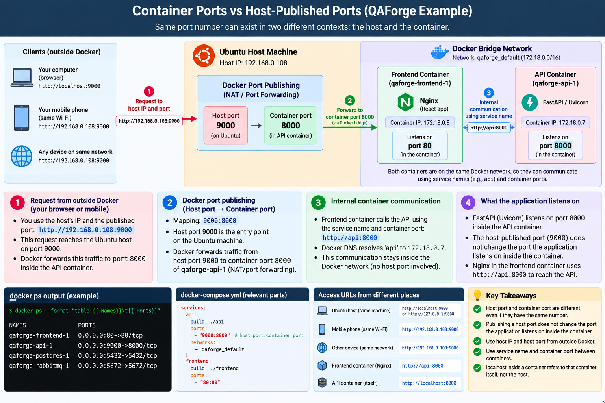
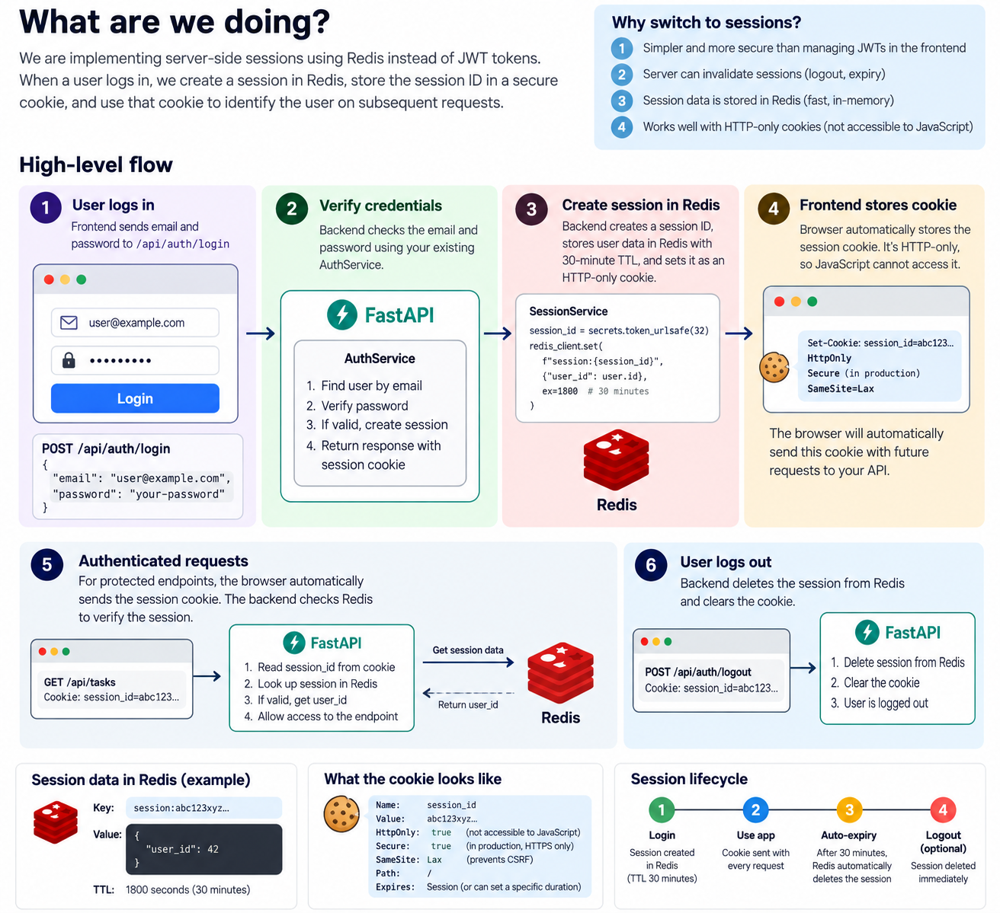

# Fast-API-Backend-Engineering

# Database Schema
users
----------------
    id
    name
    email
    password_hash

projects
----------------
    id
    name
    description

test_cases
----------------
    id
    name
    description
    status
    project_id
    created_by

test_results
----------------
    id
    test_case_id
    status
    executed_at

Relationship

        users
        │
        │
        └────────< test_cases
                        │
                        │
        projects ─────────┘
            │
            │
            └────────< test_cases
                            │
                            │
                            └──────< test_results


Current Database looks like below conceptually

                        ┌──────────────┐
                        │    USERS     │
                        ├──────────────┤
                        │ id           │
                        │ name         │
                        │ email        │
                        │ password_hash│
                        └──────┬───────┘
                               │
                               │ created_by
                               ▼
        ┌──────────────┐  ┌──────────────┐
        │   PROJECTS   │  │  TEST_CASES  │
        ├──────────────┤  ├──────────────┤
        │ id           │◄─┤ project_id   │
        │ name         │  │ id           │
        │ description  │  │ name         │
        └──────────────┘  │ description  │
                          │ status       │
                          │ created_by   │
                          └──────┬───────┘
                                 │
                                 │ test_case_id
                                 ▼
                        ┌──────────────┐
                        │ TEST_RESULTS │
                        ├──────────────┤
                        │ id           │
                        │ test_case_id │
                        │ status       │
                        │ executed_at  │
                        └──────────────┘

# QAForge API Collection Schema

                QAForge API
                │
                ├── Health
                │   └── GET    /health
                │
                ├── Auth
                │   ├── POST   /api/auth/register
                │   ├── POST   /api/auth/login
                │   ├── POST   /api/auth/refresh
                │   ├── POST   /api/auth/logout
                │   └── GET    /api/auth/me
                │
                ├── Users
                │   ├── POST   /api/users
                │   ├── GET    /api/users
                │   ├── GET    /api/users/{id}
                │   ├── PATCH  /api/users/{id}
                │   └── DELETE /api/users/{id}
                │
                ├── Projects
                │   ├── POST   /api/projects
                │   ├── GET    /api/projects
                │   ├── GET    /api/projects/{project_id}
                │   ├── PUT    /api/projects/{project_id}
                │   ├── PATCH  /api/projects/{project_id}
                │   └── DELETE /api/projects/{project_id}
                │
                ├── Project Members
                │   ├── GET    /api/projects/{id}/members
                │   ├── POST   /api/projects/{id}/members
                │   ├── PATCH  /api/projects/{id}/members/{user_id}
                │   └── DELETE /api/projects/{id}/members/{user_id}
                │
                ├── Test Suites
                │   ├── POST   /api/projects/{project_id}/suites
                │   ├── GET    /api/projects/{project_id}/suites
                │   ├── GET    /api/suites/{suite_id}
                │   ├── PUT    /api/suites/{suite_id}
                │   ├── PATCH  /api/suites/{suite_id}
                │   └── DELETE /api/suites/{suite_id}
                │
                ├── Test Cases
                │   ├── POST   /api/suites/{suite_id}/test_cases
                │   ├── GET    /api/suites/{suite_id}/test_cases
                │   ├── GET    /api/test_cases/{id}
                │   ├── PUT    /api/test-cases/{id}
                │   ├── PATCH  /api/test-cases/{id}
                │   ├── DELETE /api/test-cases/{id}
                │   └── POST   /api/test-cases/{test_case_id}/execute
                │
                ├── Test Results
                │   ├── GET    /api/test-cases/{id}/results
                │   └── GET    /api/results/{id}
                │
                └── Audit Logs
                    ├── GET    /api/projects/{id}/audit-logs
                    └── GET    /api/test-cases/{id}/audit-logs


# Passwords for Testing

    - Atharva             atharva123                  atharva@gmail.com
    - Rahul               rahul123                    rahul123@gmail.com
    - Priya               priya123                    priya123@gmail.com
    - Tony Stark          temporary123                tony@example.com
    - Point Break         PointBreak123               pointBreak@avengers.com
    - Captain America     CaptainAmerica123           captainRodgers@avengers.com
    - Peter Parket        peterParker@avengers.com    PeterParket123

# Running tests

Install the dependencies and run the baseline sanity suite:

```bash
.venv/bin/pip install -r requirements.txt
.venv/bin/python -m pytest
```

The tests in `tests/` exercise validation, authentication primitives, authorization
rules, the health response, and project-service behavior without requiring a
PostgreSQL connection.


# Research Topic for Software Testing LLM

        AI SOFTWARE TESTING
        │
        ├── 1. LLMs for Software Testing
        │
        ├── 2. LLM Test Generation
        │
        ├── 3. LLM Test Design / QA Reasoning
        │
        ├── 4. AI Testing Agents
        │
        ├── 5. Agent Architecture
        │     ├── Planning
        │     ├── Tool Calling
        │     ├── Memory
        │     ├── Observation
        │     ├── Action
        │     └── Agent Loops
        │
        ├── 6. Testing Tools
        │     ├── Browser
        │     ├── API
        │     ├── Database
        │     ├── CLI
        │     └── Cloud
        │   
        ├── 7. Test Execution
        │
        ├── 8. Test Oracle
        │
        ├── 9. Failure Analysis
        │
        ├── 10. Autonomous / Exploratory Testing
        │
        ├── 11. Multi-Agent Testing
        │
        ├── 12. Testing Memory / Knowledge
        │
        ├── 13. Evaluation & Benchmarks
        │
        └── 14. Existing Products / Research Prototypes





# Remote Machine connection from mac to ubuntu desktop

    To ssh into the Ubuntu Machine use below command:
    - ssh atharva07@192.168.0.108
    - This will connect you with Ubuntu Desktop and manage the dedicated server directly from mac without even touching the machine
    - Once you get into the server, hit the below command:
    - docker compose ps : To check the containers are running or not.

# Learn more about Database Migration

# Git based Ubuntu Server Depoloyment

    Step 1 - Make the changes on your mac
        Open Terminal one your mac
        - cd ~/fastApiQAForge
        - git status -sb
    
    Step 2 - Run the tests 
        - PYTHONPATH=. uv run pytest -q

    Step 3 - Frontend build (if you make the changes in the frontend)
        - cd qaforge-frontend
        - npm run build
        - cd ..
        
        - Proceed when tests passed

    Step 4 - Commit and push to github -> From ~/fastApiQAForge:
        - git status
        - git add .
        - git commit -m "Describe your changes"
        - git push origin main

    Step 5 - Connect to Ubuntu and fetch the changes
        - ssh atharva07@192.168.0.108

    Step 6 - Then on Ubuntu
        - cd ~/qaforge-repo
        - git status -sb

    Important: this checkout has a local modification to docker-compose.yml. It points to your existing environment file at /home/atharva07/qaforge/.env.
    Do not discard or commit that server-specific change. If Git reports that the local modification would be overwritten, stop and preserve it before pulling.
    If the checkout is clean apart from that known configuration change and Git permits the fast-forward update, run:

    Step 7 - git pull --ff-only origin main

    Step 8 - Build the new Docker images

        tmp_docker_config="$(mktemp -d)"
        trap 'rm -rf "$tmp_docker_config"' EXIT
        printf '{ "auths": {} }\n' > "$tmp_docker_config/config.json"

        DOCKER_CONFIG="$tmp_docker_config" \
        docker --host unix:///home/atharva07/.docker/desktop/docker.sock \
        compose \
            -p qaforge \
            --env-file ~/qaforge/.env \
            -f ~/qaforge-repo/docker-compose.yml \
            build api worker-1 worker-2 outbox-publisher execution-recovery frontend

    Wait for all six images to finish building successfully.
    If a build fails, don't proceed to deployment until you've understood and resolved the error.

    Step 9 - Deploy the updated services

        docker compose \
            -p qaforge \
            --env-file ~/qaforge/.env \
            -f ~/qaforge-repo/docker-compose.yml \
            up -d --no-deps \
            api worker-1 worker-2 outbox-publisher execution-recovery frontend

    Step 10 - Verify the deployment
        Run on Ubuntu
        
        docker compose \
            -p qaforge \
            --env-file ~/qaforge/.env \
            -f ~/qaforge-repo/docker-compose.yml \
            ps

        Then

        curl -I --max-time 10 http://localhost/
        curl -I --max-time 10 http://localhost:8000/docs


# How Docker Image build workflow looks




# Notes:

    - The browser your Ubuntu server through a published port, while Nginx reached fast API through Internal Docker network. Those two are different newtwork paths.
    - How to read IP addresses and ports
        - 0.0.0.0:8000->8000/tcp
        - 0.0.0.0 -> Docker published the port on all IPv4 network interfaces of the host
        - First 8000 -> The host-published port
        - Second 8000 -> The destination port inside the container
    
    - Why we can use api:8000 without publishing port 8000 ?
        - That works because the frontend and API share the qaforge_default Docker network. They communicate using the service name api and container port 8000
    - Container-to-Container traffic on shared network does not require publishing the API port to the host.
    - Port publishing is for connections entering through the host's network interfaces. Internal container communication uses docker networks directly.
    
    - What is uvicorn ?
        - 

    - What actually makes a port reachable ?
        - There are three separate things to understand ?
        - Application listening: Uvicorn must listen on correct address and port
        - Container networking: Docker must allow the source to reach that container
        - Port Publishing: Docker exposes the host-side port and forwards traffic to the container port

    - What is DNS ?
        - DNS Stands for Domain Name System. Its job is to transalte a hostname into IP Address so a client can find the destination
        - In our project, The frontend uses api, rather than hard-coding 172.18.0.7, because container IP can change when containers are recreated.

        - Server:    127.0.0.11
        - Address:   127.0.0.11:53

        - Name:      api
        - Address:   172.18.0.7

        - Here's how to read it:
            - 127.0.0.11 = DNS resolver
            - api = hostname
            - 172.18.0.7 = resolved IP (this can change if the container restared or built again)
        - DNS resolves the hostname, not the port
        
# QAForge Docker setup from end to end



# Docker Host-Published Ports vs Container Ports






# Implementing Session based login using Redis

